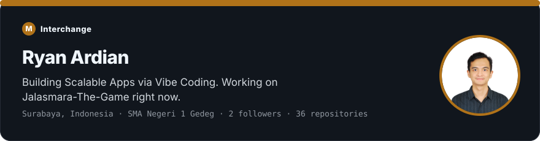
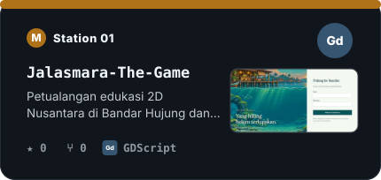
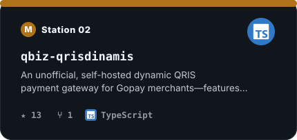
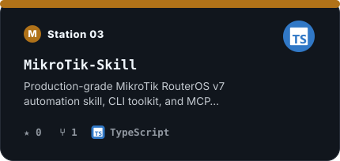
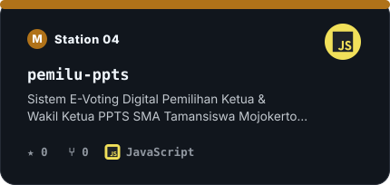
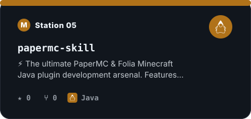
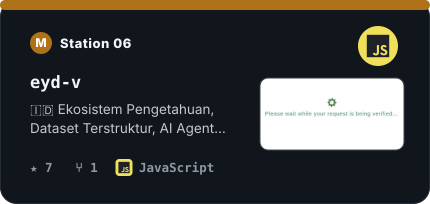

  <picture>
    <source media="(prefers-color-scheme: light)" srcset="https://raw.githubusercontent.com/ardianryan/ardianryan/main/profile-assets/metro-map-light.svg" />
    
  </picture>

  🚇 Every line is a language I write; every stop is one of my projects.

  <picture>
    <source media="(prefers-color-scheme: light)" srcset="https://raw.githubusercontent.com/ardianryan/ardianryan/main/profile-assets/metro-about-light.svg" />
    
  </picture>

  <a href="https://github.com/ardianryan/Jalasmara-The-Game"><picture><source media="(prefers-color-scheme: light)" srcset="https://raw.githubusercontent.com/ardianryan/ardianryan/main/profile-assets/metro-card-0-light.svg" /></picture></a> <a href="https://github.com/ardianryan/qbiz-qrisdinamis"><picture><source media="(prefers-color-scheme: light)" srcset="https://raw.githubusercontent.com/ardianryan/ardianryan/main/profile-assets/metro-card-1-light.svg" /></picture></a>

  <a href="https://github.com/ardianryan/MikroTik-Skill"><picture><source media="(prefers-color-scheme: light)" srcset="https://raw.githubusercontent.com/ardianryan/ardianryan/main/profile-assets/metro-card-2-light.svg" /></picture></a> <a href="https://github.com/ardianryan/pemilu-ppts"><picture><source media="(prefers-color-scheme: light)" srcset="https://raw.githubusercontent.com/ardianryan/ardianryan/main/profile-assets/metro-card-3-light.svg" /></picture></a>

  <a href="https://github.com/ardianryan/papermc-skill"><picture><source media="(prefers-color-scheme: light)" srcset="https://raw.githubusercontent.com/ardianryan/ardianryan/main/profile-assets/metro-card-4-light.svg" /></picture></a> <a href="https://github.com/ardianryan/eyd-v"><picture><source media="(prefers-color-scheme: light)" srcset="https://raw.githubusercontent.com/ardianryan/ardianryan/main/profile-assets/metro-card-5-light.svg" /></picture></a>

  <picture>
    <source media="(prefers-color-scheme: light)" srcset="https://raw.githubusercontent.com/ardianryan/ardianryan/main/profile-assets/metro-stack-light.svg" />
    
  </picture>

  <picture>
    <source media="(prefers-color-scheme: light)" srcset="https://raw.githubusercontent.com/ardianryan/ardianryan/main/profile-assets/metro-log-light.svg" />
    
  </picture>

  <picture>
    <source media="(prefers-color-scheme: dark)" srcset="https://raw.githubusercontent.com/ardianryan/ardianryan/output/github-snake-dark.svg" />
    <source media="(prefers-color-scheme: light)" srcset="https://raw.githubusercontent.com/ardianryan/ardianryan/output/github-snake.svg" />
    
  </picture>

  
<strong>🏫 Enterprise & School Systems (Live Deployments & Architecture)</strong>

   

<table>
  <tr>
    <td width="50%" valign="top">
      <h3>🏫 AKAS v2 — Academic Security System</h3>
      
A school discipline & academic monitoring platform. Migrated from PHP Native monolith to a modern <strong>Laravel + React (Inertia.js)</strong> SPA architecture with shadcn/ui components, Google OAuth SSO, Cloudflare R2 storage, and PWA support.

      

        
        
        
        
        
      

      
<strong>Status:</strong> 🌐 Live at <a href="https://akas.smage.my.id">akas.smage.my.id</a>

    </td>
    <td width="50%" valign="top">
      <h3>🍢 Satenya Mama Loesye — POS & Management System</h3>
      
A modern Point of Sales & catering management system with a bold neobrutalist UI. Features Kitchen Display System, dynamic QRIS payment, WhatsApp OTP login, advanced catering builder, promo/coupon engine, and multi-address delivery management.

      

        
        
        
        
        
      

      
<strong>Status:</strong> 🌐 Live at <a href="https://satenyamamaloesye.ppti.me">satenyamamaloesye.ppti.me</a>

    </td>
  </tr>
  <tr>
    <td width="50%" valign="top">
      <h3>🎓 ScholarGate SSO — School Portal & CMS</h3>
      
A school education portal with a full Admin CMS, shared-hosting friendly deployment, and a cheerful bento-grid public UI. Features Google OAuth SSO, Cloudflare R2 media storage, SEO-ready sitemap, and multi-database support (PostgreSQL, MySQL, MariaDB).

      

        
        
        
        
        
      

      
<strong>Status:</strong> 🌐 Live at <a href="https://portal.sman1gedeg.sch.id">portal.sman1gedeg.sch.id</a>

    </td>
    <td width="50%" valign="top">
      <h3>📋 SIEKSA V3 — School Extracurricular System</h3>
      
A web-based extracurricular management platform for schools — handles member management, attendance journals, achievement tracking, and student performance scoring. Integrates with ScholarGate SSO and supports external API for third-party systems.

      

        
        
        
        
        
      

      
<strong>Status:</strong> 🌐 Live at <a href="https://sieksa.smage.my.id">sieksa.smage.my.id</a>

    </td>
  </tr>
</table>

---

 

Commit Metro · every line is a language, every stop a project · engineered by <a href="https://github.com/ardianryan">@ardianryan</a>

 

**"The network is the computer."** – John Gage

